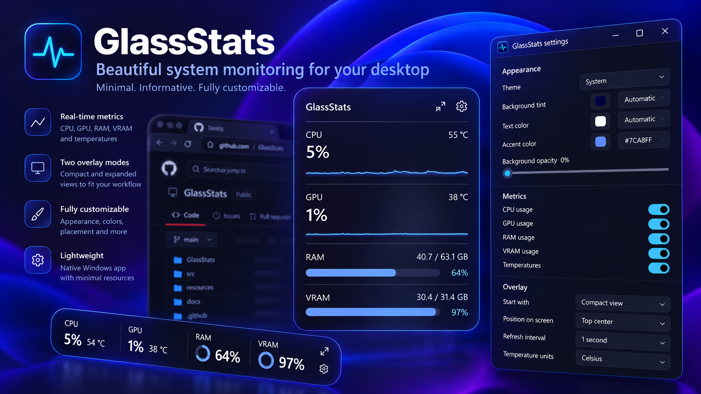

# GlassStats Qt

C++20 / Qt Quick remake of [GlassStats](https://github.com/eduardojsborges/GlassStats): a movable glass performance overlay with full and compact layouts, CPU/GPU usage, RAM/VRAM, temperatures, graphs, adaptive text, and app attachment.

**0.2.0-alpha.1 is a development preview.** The Windows implementation is under parity validation. Linux/macOS backends are experimental; building successfully does not establish hardware or desktop compatibility. The original C# app remains available separately.

## Platforms

| Target | Implementation and limits |
| --- | --- |
| Windows 11 x64 | Native PDH/DXGI/memory monitoring, GDI adaptive text, WinEvent attachment, shortcuts, startup, tray. Validation results: [VALIDATION.md](VALIDATION.md). |
| Windows 10 22H2 x64 | Build/install target; real-device validation required. Native blur can fall back to translucent tint. The optional .NET helper has its own runtime/OS support policy. |
| Ubuntu 24.04 x64 | `/proc`, hwmon, DRM and optional NVML monitoring. X11 and Wayland are distinct capabilities; real desktop/hardware testing required. |
| macOS 14.4+ Intel/Apple Silicon | Mach CPU/RAM, Metal adapter discovery and native glass. Aggregate GPU load, system GPU allocations and temperatures are unavailable until a validated provider exists. Unified memory is not dedicated VRAM. |

Unsupported readings show **— / Unavailable / Stale**, never synthetic zeroes. Settings explains permissions and platform capabilities. Normal monitoring works offline, without accounts or telemetry.

## Use

- Drag noninteractive card areas; release to fit the card to the monitor or attached window. Position and independent sizes are remembered.
- Click the view control beside the gear for **CPU → GPU → RAM → VRAM** full/compact views. Hover compact metrics for live details.
- Right-click the card or tray/menu-bar icon for Settings, view, lock, hide, attachment, recovery, and quit.
- **Ctrl+Alt+O** toggles click-through; **Ctrl+Alt+U** detaches, unlocks and restores the desktop position. Shortcuts are configurable and conflicts are reported. Tray recovery remains available when the desktop supplies a tray.
- **Glue to app…** selects one window for the session. Escape/Cancel/30-second timeout cancels. The card follows movement, resizing, minimization and overlap. Closing the target returns it to the desktop. Readings remain system-wide.
- Customize theme, color wheel/hex colors, opacity, fonts, 67–167% scale, corners, metric visibility, graphs, 0.5/1/2-second refresh, units, GPU and sensors. Both views reset together.
- **Adapt text to background** changes foreground colors while preserving readable custom colors and chosen opacity. **Protect text contrast** independently adds a readable glass veil. Local capture buffers are never saved/transmitted; normal screenshots include GlassStats.

Qt uses a separate preference directory (`GlassStats-Qt` under the OS's local application data). First launch offers a read-only copy/import of legacy Windows settings. Legacy preferences and the old updater are untouched. Switching sign-in startup requires an explicit choice if the old app already starts automatically.

See [migration and rollback](docs/MIGRATION.md) and [platform compatibility](docs/COMPATIBILITY.md) for details.

Windows temperatures use the retained, isolated .NET/LibreHardwareMonitor bridge: unelevated GPU readings plus an optional administrator-installed service for CPU access. Settings provides setup/removal; cancellation leaves other metrics operational. The service/pipe are separate from the C# edition, read-only, user/SYSTEM restricted, and sample only with a connected overlay. The shared PawnIO driver is retained on uninstall.

## Experimental desktop integrations

On Linux/macOS, attachment remains opt-in and unverified: `GLASSSTATS_EXPERIMENTAL_WINDOWING=1`. X11 attachment needs an accessible window identity. Standard Wayland does not provide the required global positioning/window control; attachment stays unavailable there. macOS requires Accessibility permission and still needs overlap/client-area validation.

Experimental X11/macOS screen analysis requires `GLASSSTATS_EXPERIMENTAL_CAPTURE=1`; macOS also requires Screen Recording permission. Without access, foreground glyph halos protect readability. These flags do not imply feature parity. GPU/sensor availability depends on hardware and drivers.

Linux click-through requires a working desktop tray during this experimental phase, so locking cannot remove the available recovery control. Native Wayland global shortcuts are unavailable until portal integration is validated.

## Build and packages

See [DEVELOPMENT.md](DEVELOPMENT.md) for pinned Qt setup, CMake builds, tests, validation fixtures, and platform packaging. Qt is dynamically linked. A ready-to-run portable Windows copy must contain the whole deployed folder, not only the EXE. Source archives are not app packages.

Preview packaging produces a Windows installer/ZIP, Linux AppImage, and separate Mac Intel/ARM64 DMGs. Public release publication follows package validation. Current packages are unsigned/unnotarized unless release notes explicitly say otherwise.

The Qt updater checks **eduardojsborges/GlassStats-Qt**, independently of the old app. Daily checks can be disabled; manual checks, prerelease filtering, release notes, explicit download/install confirmation and SHA-256 verification are included. Migration from the old release is manual.

Original GlassStats code and this remake are [MIT licensed](LICENSE). Qt and bundled dependencies retain their [own licenses](licenses/README.md). [FEATURES.md](docs/FEATURES.md) tracks parity; [ARCHITECTURE.md](docs/ARCHITECTURE.md) explains native boundaries.
